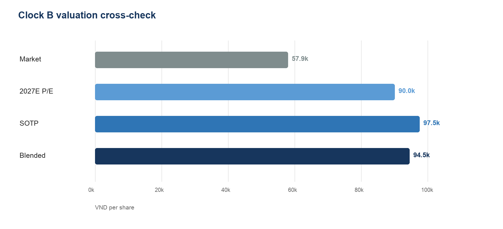
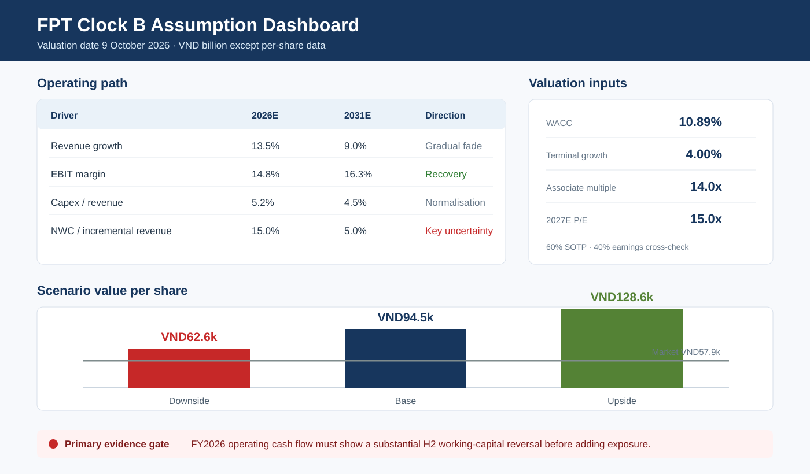
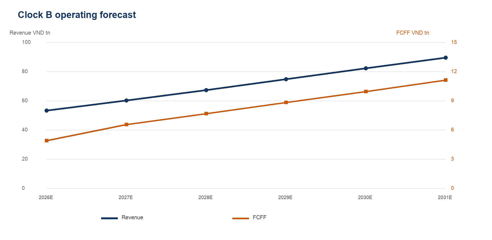

# FPT Equity Valuation Workbench

Point-in-time equity research on FPT Corporation (HOSE: FPT), built to demonstrate senior-level financial analysis, valuation judgement, model governance and decision monitoring in a Vietnam-market context.

[](https://github.com/thvh2006/fpt-equity-valuation-workbench/actions/workflows/quality.yml)
[](https://github.com/thvh2006/fpt-equity-valuation-workbench/actions/workflows/live-monitor.yml)

This is portfolio research, not investment advice.



## Three-minute review

If you only have three minutes:

1. **Decision:** Base fair value is VND94,498 versus a VND57,900 market price, but the rating is high risk.
2. **Variant view:** disclosed demand indicators imply a less severe slowdown than the observed trailing multiple suggests.
3. **Accounting judgement:** FPT Telecom moved to the equity method, so Clock B uses an operating DCF plus separately capitalised associate earnings.
4. **Falsification test:** do not add exposure unless FY2026 operating cash flow shows a substantial second-half working-capital reversal.
5. **Audit trail:** the Python engine reproduces Excel, 19 checks pass, and Clock A remains frozen for backtesting.

Open the [eight-page decision report](reports/fpt_equity_update_report_clock_b_v1_0.pdf), the [live workbook](reports/fpt_equity_valuation_v0_8.xlsx), or the [model card](docs/MODEL_CARD.md).

For an in-browser audit of the evidence chain, open the [executed valuation research walkthrough](notebooks/01_valuation_research_walkthrough.ipynb).

## Decision snapshot

| Clock B at 9 October 2026 | Result |
|---|---:|
| Market price | VND57,900 |
| SOTP value | VND97,511 |
| 2027E P/E cross-check | VND89,978 |
| Blended fair value | VND94,498 |
| Upside | 63.2% |
| Mechanical rating | BUY |
| Risk label | HIGH |

The investment conclusion is deliberately conditional: the valuation gap supports measured exposure, but additional position size requires FY2026 evidence that the H1 working-capital outflow reverses.

## Why this project is different

- **Two research clocks.** Clock A is frozen at 31 October 2025 and tested against FY2025 actuals. Clock B is a separate live underwriting cycle at 9 October 2026.
- **Accounting-basis control.** FPT Telecom moved from full consolidation to the equity method in 2026. Clock B uses an operating DCF plus separately capitalised associate earnings to avoid false comparisons and double counting.
- **Decision architecture.** Valuation, variant view, risks, explicit monitoring thresholds and escalation rules are connected.
- **Independent calculation engines.** The reviewed Excel model and a standard-library Python model reproduce the same Base valuation.
- **Auditability.** Source dates, cutoffs, checksums, reported-data tests and post-cutoff rules are documented.

## Start here

1. Read the [Clock B PDF report](reports/fpt_equity_update_report_clock_b_v1_0.pdf).
2. Review the [Clock B workbook](reports/fpt_equity_valuation_v0_8.xlsx), especially `Clock B Summary`, `Clock B Assumptions`, `Clock B Valuation`, `Clock B Monitor` and `Checks`.
3. Inspect the [executed valuation research walkthrough](notebooks/01_valuation_research_walkthrough.ipynb) for evidence receipt, data diagnostics, charts, valuation outputs and decision limits.
4. Read the concise [investment-committee memo](docs/CLOCK_B_IC_MEMO.md).
5. Inspect [reproducibility instructions](REPRODUCIBILITY.md) and run the independent model.
6. Review the [investment outcome log](docs/INVESTMENT_OUTCOME.md) and live evidence policy.
7. Use Clock A only to assess historical process discipline and forecast error.

## Reproduce the analysis

Python 3.10 or newer is sufficient; the core Clock B implementation uses only the standard library.

```bash
python scripts/run_clock_b.py
python scripts/run_checks.py
```

Expected Base result: VND94,498 blended value, 63.2% upside and a mechanical BUY. The second command runs 19 data-integrity, accounting, cash-flow, valuation and release-governance checks.

## Deliverables

### Clock B current view

- `reports/fpt_equity_valuation_v0_8.xlsx` — 23-sheet live SOTP model with Base, Downside and Upside cases, H1/8M2026 evidence, sensitivity, charts, thesis monitor and audit checks.
- `reports/fpt_equity_update_report_clock_b_v1_0.pdf` — portfolio-ready eight-page update report.
- `reports/fpt_equity_update_report_clock_b_v1_0.docx` — editable report source.
- `reports/clock_b_summary.json` — machine-readable output from the independent Python engine.
- `docs/CLOCK_B_VALUATION_NOTE.md` — valuation method and assumptions.
- `docs/CLOCK_B_IC_MEMO.md` — decision memo and position-sizing rules.

### Clock A historical process

- `reports/archive/fpt_equity_valuation_v0_7.xlsx` — frozen Clock A plus FY2025 post mortem.
- `reports/fpt_equity_initiation_report_clock_a_v1_0.pdf` — ten-page historical initiation report.
- `reports/fpt_equity_initiation_report_clock_a_v1_0.docx` — editable report source.
- `reports/archive/` — prior workbook versions retained for audit history without cluttering the primary deliverables.

### Research governance

- `configs/sources.yaml` — source register, dates, cutoffs, checksums and allowed usage.
- `docs/RESEARCH_LOG.md` — chronological research decisions.
- `docs/FORECAST_BACKTEST_NOTE.md` — anti-leakage design and FY2025 error attribution.
- `docs/DATA_MODEL.md` — analytical data design.
- `docs/MODEL_CARD.md` — intended use, calculation sequence, scenario governance and limitations.
- `docs/INVESTMENT_OUTCOME.md` — price, benchmark, valuation-gap and thesis-outcome protocol.
- `tests/` — reported-data and valuation checks.

## Valuation architecture

Clock B values continuing consolidated operations with FCFF, capitalises 2027E associate and joint-venture earnings separately, adds cash and short-term investments, subtracts debt and non-controlling interests, then divides by post-bonus shares. A 2027E P/E cross-check receives 40% weight; SOTP receives 60%.

Base WACC is 10.89% and terminal growth is 4.0%. Explicit FCFF covers 2027E–2031E with mid-year discounting. Associate book value is shown for reference but not added to equity value because earnings are already capitalised.



## Primary risk and falsification rule

H1 operating cash flow was negative VND1.15tn while parent net profit was VND5.05tn. Cash conversion is the only red quantitative indicator and the key evidence required to confirm the thesis.

Re-underwrite if revenue growth falls below 10%, EBIT margin falls below 14%, capex exceeds 6.5% of revenue, or two live indicators become red. Do not increase exposure before FY2026 operating cash flow shows a substantial second-half reversal.

## Investment outcome

Clock B was opened on 9 October 2026. As of 12 October 2026, the observation window is too short for a meaningful performance score, so the status remains **OPEN — EVIDENCE PENDING**.

`data/sample/investment_outcomes.csv` preserves the original price and fair value. `scripts/update_investment_outcome.py` appends later price, benchmark, active-return and thesis-status observations without rewriting history. Six- and twelve-month scorecards are scheduled for 9 April and 9 October 2027.

## Live research loop

The repository does not pretend that source changes should automatically change a recommendation. Instead, the live monitor separates detection from analyst judgement:

1. GitHub Actions checks official FPT evidence every Monday and can also run manually.
2. A normalised-content fingerprint detects changed or unavailable pages.
3. The workflow uploads a source-status artifact and opens one review issue when evidence changes.
4. A human reviewer verifies the disclosure, establishes a new information cutoff and reruns the model.
5. Any changed thesis receives a new clock; historical outputs are never overwritten.

Run the monitor locally with:

```bash
python scripts/check_live_sources.py --fail-on-change
```



## Repository map

```text
configs/        project and source governance
data/sample/    redistributable public-source and derived inputs
docs/           research notes, model cards and decision memos
assets/readme/  decision previews for a three-minute review
reports/        selected Excel, DOCX, PDF and JSON outputs
reports/archive historical workbook build retained for auditability
scripts/        reproducible model runner and dependency-free checks
src/            reusable valuation logic
tests/          accounting, extraction and valuation assertions
```

## Limitations

- The 2026 full-year forecast annualises eight-month revenue and six-month margin evidence.
- The associate line includes associates and joint ventures beyond FPT Telecom.
- Current peer estimates were not licensed for redistribution; the P/E cross-check uses an explicit analyst assumption.
- H1 operating cash flow is not annualised because working-capital timing can reverse in the second half.
- Public-source facts remain subject to issuer restatement and source availability.

## Licence and attribution

Original code and documentation are MIT-licensed. Third-party reports, market data, trademarks and source documents are excluded from that licence; see [NOTICE.md](NOTICE.md).
